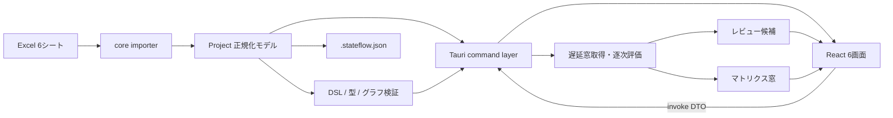

# STATEFLOW 技術設計書

更新日: 2026-11-16（Asia/Tokyo） / 対象コード: repository `main` の v0.0.1 系。最新の実装状態は [AI引き継ぎ書](AI_HANDOFF.md)、実測結果は [検証記録](TEST_REPORT.md) を参照。

## 1. 目的と境界

STATEFLOWは、Excelで定義した複数の状態遷移モデルを統合し、イベント1件の入力変化と全機能状態の直積を独立した試験ケースとして評価するWindowsデスクトップアプリである。各ケースでは全機能をノードのx位置順に1回ずつ評価し、各機能の次状態と判定根拠を表示する。

この結果は状態遷移表を確認するための1ステップ解析である。実機の周期実行、割込、並列動作、到達可能性や多ステップデッドロックを証明しない。レビュー候補は設計者が確認する対象であり、不具合判定ではない。

## 2. 情報の優先順位

| 情報 | 正とする内容 |
| --- | --- |
| `STATEFLOW_実装指示書.md` | 業務ルール、受入条件、正式Excel仕様、未対応境界 |
| `references/STATEFLOW_UI_Prototype_v6.html` | 承認済み画面構成、視覚設計、操作導線 |
| 本書 | コードの責務分担、現在の実装契約、コード位置 |
| `docs/IMPLEMENTATION_STATUS.md` / `docs/TEST_REPORT.md` | 実装済み範囲、確認済み範囲、残作業 |
| ソースコード | 実際の現在動作。仕様との差があれば引き継ぎ書へ記録し、仕様を黙って書き換えない |

プロトタイプ内の固定デモ計算は解析仕様ではない。業務判断では仕様書、実動作の調査ではRustコアを確認する。

## 3. コンポーネントとデータフロー



解析、Excel読込、プロジェクト保存、検証、窓取得は `crates/stateflow-core` が正である。Tauri層は `src-tauri/src/commands.rs` でIPCとアプリ状態を管理し、UIはRustの結果を表示する。Reactで状態遷移計算を再実装しない。

### 主なコードの場所

| 責務 | ファイル |
| --- | --- |
| ID、Project、Scenario、guard AST、グラフ、レビュー型 | [model.rs](../crates/stateflow-core/src/model.rs) |
| Excelシート読込・型変換・出典位置 | [importer.rs](../crates/stateflow-core/src/importer.rs) |
| ガード式 tokenizer / parser | [dsl.rs](../crates/stateflow-core/src/dsl.rs) |
| 型・状態・グラフ・参照検証 | [validation.rs](../crates/stateflow-core/src/validation.rs) |
| Cartesian product、実行順、step評価、trace、matrix窓 | [engine.rs](../crates/stateflow-core/src/engine.rs) |
| レビュー候補・fingerprint/evidence・判定保存 | [review.rs](../crates/stateflow-core/src/review.rs) |
| `.stateflow.json` のatomic save / load | [project_file.rs](../crates/stateflow-core/src/project_file.rs) |
| Tauri IPCコマンドとCSV | [commands.rs](../src-tauri/src/commands.rs) |
| Rust DTOとReactの通信関数 | [tauri.ts](../src/lib/tauri.ts) |
| 共有プロジェクト状態、上部バー、6画面の切替 | [App.tsx](../src/app/App.tsx), [uiStore.ts](../src/app/uiStore.ts) |
| 6画面 | `src/features/{matrix,review,graph,rules,execution}/` |

## 4. ドメインモデル

`Project`はschema version、ID、revision、機能、状態、入力、出力、イベント、遷移、ノードと接続、Scenario、レビュー設定・判定、取込元hashを持つ。

- `MachineId`, `StateId`, `InputId`, `OutputId`, `EventId`, `RuleId`はRust newtype。
- `TypedValue`はBoolean / Enum / Number / String / Unknown。
- `GuardExpr`はLiteral / Reference / Rise / Fall / Compare / Not / And / Or。
- `Scenario`は`fixed_inputs`, `previous_states`, `previous_outputs`を別々に持つ。
- `revision`は編集時に増やす。解析要求はrevisionと一致しない場合、古い結果として拒否する。
- `SourceLocation`はファイル名、sheet、行、列を保持し、ルールとイベントから入力元を辿れる。

## 5. Excel入力契約

配布する入力例は [templates/stateflow_input_v1.xlsx](../templates/stateflow_input_v1.xlsx)。標準仕様の詳細は仕様書4章。1行目はカラム名、2行目以降がデータ。アプリ取込用のシートは以下の6つで、列ヘッダーは小文字にtrimして照合する。

| Sheet | 必須列 | 任意列 |
| --- | --- | --- |
| `Machines` | `machine_id`, `machine_name`, `initial_state_id` | `step_order`, `description` |
| `States` | `machine_id`, `state_id`, `state_name` | なし |
| `Inputs` | `input_id`, `input_name`, `input_type`, `allowed_values`, `default_value` | `unit` |
| `Outputs` | `output_id`, `owner_machine_id`, `output_name`, `output_type`, `allowed_values` | `default_previous_value` |
| `Events` | `event_id`, `event_name`, `input_id`, `from_value`, `to_value`, `enabled` | なし |
| `Transitions` | `rule_id`, `machine_id`, `from_state_id`, `guard`, `to_state_id`, `priority` | `source_ref`, `description` |

型/domainの実装表現:

- BOOL: `OFF|ON`または`ON|OFF`。値は`OFF` / `ON`、または`FALSE` / `TRUE`。
- ENUM: `A|B|C`のように一意な値を`|`区切り。
- NUMBER: `最小..最大`。片側を空欄にして上限/下限のみ指定できる。単一数値はその値だけを許容。
- STRING: 任意文字列。
- `priority`は有限な0以上の整数。値が小さいルールを優先する。
- IDの大文字小文字はimporterで正規化されない。仕様書推奨に合わせ、ASCII英数字と`_`、大文字IDで統一する。
- 複数ブックはシート単位で統合できる。統合後、必須6シートが揃う必要がある。重複IDや参照不整合は診断対象。
- 取込上限は1ファイル100 MiB、各統合シート100,000データ行。未知シートは警告対象。
- 現コードは未知の列を警告していない。将来、仕様書4.1の「未定義列診断」を実装する場合は回帰テストを追加する。

テンプレートは架空のAC / LINK / HEATER例で、CURRENT参照2つを含む。取込直後のグラフ接続は意図的に0本であるため、`AC → LINK`と`LINK → HEATER`をCURRENTで手動接続するまで解析できない。Excel側に接続情報を書いて自動配線させない。

## 6. ガードDSLと参照の意味

`parse_guard()`は文字列をtokenizeしてASTにする。許可された比較は`==`, `!=`, `<`, `<=`, `>`, `>=`。論理演算は`NOT`, `AND`, `OR`、関数は`RISE(input_id)`, `FALL(input_id)`。評価にJavaScript `eval`等を使わない。

| DSL参照 | 読む値 |
| --- | --- |
| `INPUT.X` | イベント変化後のX。対象外の入力はScenarioの固定値、なければExcel default |
| `STATE.M` | 同じstep内で、評価時点の最新状態 |
| `BEFORE.STATE.M` | 今回のstep開始時の状態 |
| `PREV.STATE.M` | 独立Scenarioに設定された前回確定状態 |
| `PREV.OUTPUT.O` | 宣言済み出力のScenario前回値。出力の現在値は計算しない |
| `RISE(X)` / `FALL(X)` | 対象イベント入力のBOOL OFF→ON / ON→OFF |

`STATE`, `BEFORE.STATE`, `PREV.STATE`, `PREV.OUTPUT`は別ソースであり、未設定の履歴は`UNKNOWN`のまま扱う。`UNKNOWN`比較は`UNKNOWN`。AND/ORは3値論理で、FALSE AND UNKNOWNはFALSE、TRUE OR UNKNOWNはTRUE。

## 7. グラフと逐次評価

取込時にMachinesごとのGraphNodeだけを初期生成する。`graph_edges`は空配列である。グラフのx昇順が実行順序で、x重複・不正座標・左→右でない辺はvalidation error。

| Graph edge kind | 参照契約 | 実行順序 |
| --- | --- | --- |
| `CurrentState` | ターゲットguardの`STATE.<source>`を解決 | sourceを先に評価 |
| `PreviousState` | `PREV.STATE.<source>`を解決 | sourceを先に評価 |
| `PreviousOutput` | source所有の出力IDを`PREV.OUTPUT.<id>`へ束縛 | sourceを先に評価 |
| `FlowOnly` | 値参照なし | sourceを先に評価 |

CURRENT / PREVIOUS / FLOW_ONLYは見た目の線種だけでなくRustモデルの契約。CURRENT参照はCURRENT辺、PREV参照は対応するPREVIOUS辺が必要。自己機能の参照は自己接続不要。線を引いてもguard式は書き換わらない。

評価の流れ:

1. 現在状態の組み合わせを`S0`として複製し、同じ値を不変`BEFORE.STATE`に保持。
2. 固定入力を読み、イベント入力のみ`from_value`と`to_value`でbefore/afterを作る。
3. graph nodeをx昇順で走査し、各機能を1回だけ評価。
4. 評価機能の現在状態と一致するfrom-stateのルールだけを抽出。全guardを評価して部分式traceを記録。
5. TRUEのうち最小priorityを採用。同priorityで異なる行先があればCONFLICT。同じ行先ならrule ID順で決定し、選択根拠をtraceへ残す。
6. 同順位またはそれより上のpriorityにUNKNOWNがあれば判定不能。TRUEがなくUNKNOWNがあれば状態維持とはせず判定不能。TRUEの最小priorityより低優先（数値が大きい）のUNKNOWNは採用結果を変えない。
7. 成立ruleがなければ`ImplicitHold`、同じ状態への遷移ruleなら`ExplicitHold`、異なる状態なら`Changed`。
8. 後続機能は先行機能が確定した最新`STATE`を読む。過去に評価した機能へ戻って再実行しない。

現コードの`CellStatus`は`changed`, `explicit_hold`, `implicit_hold`, `indeterminate`, `conflict`。次状態を一意に決められない場合は`next_state: null`。直積は到達可能性を意味しない。

## 8. 大規模データとRevision

組み合わせ数は各機能の状態数の積。`count_combinations()`は`u128` checked multiplyを使い、組み合わせIDは`COMBO-`と1始まりのゼロ埋めindex。機能のx順で状態軸を組み立て、右端の機能の状態が最速で変化する。

- `get_matrix_metadata`: event/machine/combination数。大きな組み合わせ数は文字列。
- `get_matrix_window`: event index範囲とcombination index範囲から必要セルだけ生成。最大50,000セル/要求。
- `get_cell_trace`: 1 event + 1 combinationについて全機能のrule・部分式traceを返す。
- Reactのマトリクスは縦横仮想化し、スクロール範囲の窓だけ取得する。古い要求をrequest generationで捨てる。
- revision不一致のmatrix / review queryは`STALE_REVISION`。
- Matrix CSVはRust側で分割して書き、1回10,000,000セル上限。
- Review scanは100,000 event×combination step上限、1 page 200件、強調窓50,000セル、review CSV 100,000候補上限。

## 9. 保存、Tauri、画面

### 保存

`.stateflow.json`は`schema_version: 1`。正規化モデル、配線・座標、Scenario、レビュー設定と判定、source hashを含む。`project_file.rs`は同じディレクトリの一時ファイルを書いてflush/sync後にrenameする。バージョン不一致を自動移行せず説明付きで拒否する。

### IPC

IPC handler登録元は`src-tauri/src/lib.rs`。主なコマンドはExcel import、project open/save、validate、graph/scenario/review settings更新、matrix metadata/window/trace、review page/window/decision、CSV export。Reactからは`invokeCommand<T>()`経由で呼ぶ。

編集commandは`base_revision`を照合し、古い編集を拒否する。エラーDTOはcode/message/detail/source locationを持つ。matrix / reviewはrevisionを照合する。

### 画面

| UI | 実装ファイル | 主なデータ |
| --- | --- | --- |
| 統合マトリクス | `src/features/matrix/MatrixPage.tsx` | metadata、二方向virtual窓、セルtrace、レビュー強調 |
| 連動レビュー候補 | `src/features/review/ReviewPage.tsx` | page、filters、judgment/note、CSV |
| レビュー抽出設定 | `src/features/review/ReviewSettingsPage.tsx` | enabled rules/machines/events |
| 依存関係・実行順序 | `src/features/graph/GraphPage.tsx` | node position、typed edges、inspection |
| 遷移ルール | `src/features/rules/RulesPage.tsx` | normalized rule/guard/source location |
| 実行設定 | `src/features/execution/ExecutionSettingsPage.tsx` | read-only x order and fixed/previous values |

画面全体の白/チャコール/グレー/赤、6画面、ダークグラフは参照HTMLの設計契約。機能変更で別デザインへ置き換えない。

## 10. レビュー抽出と判定

候補は遷移結果から別途作る。レビュー設定の切替は遷移計算そのものを変えない。候補fingerprintは安定ID、evidence hashは根拠変更の検出に使い、判定の根拠が変わると`needs_recheck`となる。

| ID | Rust enum | 現状 |
| --- | --- | --- |
| R01 | `UpstreamChangedDownstreamHeld` | CURRENT辺の上流が変化し、接続先が明示/暗黙保持なら候補 |
| R02 | `PreviousValueSuppressed` | guardのPREV値を代替した時に式全体がTRUEになる場合のみ抑止根拠を作る |
| R03 | `OrderMissedUpdate` | enum、画面ラベル、IDコードはあるが、現`review.rs`に候補生成処理がない（未実装） |
| R04 | `ImplicitHold` | 暗黙保持を選択的に候補化 |
| R05 | `AllMachinesHeld` | 全機能が保持した場合に候補化 |

R01/R02/R04/R05でもレビュー候補は不具合確定ではない。判断状態は`Pending`, `ExpectedByDesign`, `NeedsCorrection`, `Deferred`。レビュー設定画面がR03をON表示しても現在候補を生成しないため、改善時にUI文言と実装を同期する。

## 11. 検証と変更時の注意

代表コマンド:

```powershell
npm ci
npm run tauri -- dev
npm run typecheck
npm test
npm run build
cargo fmt --all -- --check
cargo test -p stateflow-core
cargo clippy -p stateflow-core --all-targets -- -D warnings
npm run tauri -- build
```

ルール評価を変える場合は、`crates/stateflow-core/tests/golden_model.rs`と`tests/fixtures/golden-workbook.xlsx`を使い、Golden A〜Gを壊していないか確認する。DSLや型変更には`dsl.rs`と`validation.rs`のユニット/統合テストを追加する。Excelスキーマ変更には正式テンプレート、importer、fixtureテスト、利用説明を同じ変更で更新する。UI変更には参照HTMLとの実画面確認と`docs/qa/`の証跡更新が必要。

受入未確認項目は[AI引き継ぎ書](AI_HANDOFF.md)に整理してある。「テストが通った」ことと「仕様書11章を全受入した」ことを混同しない。
